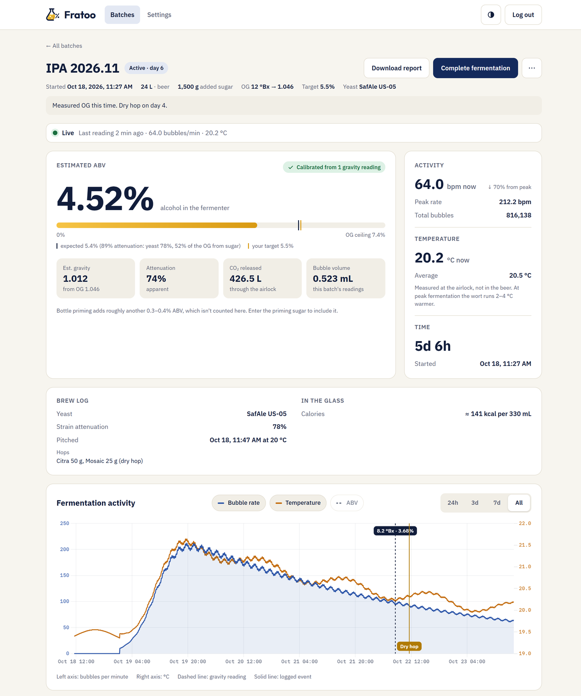
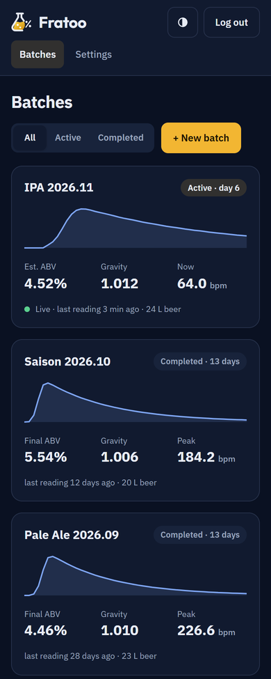

# Fratoo

Self-hosted fermentation monitoring for the **Plaato Airlock**. A small server speaks the
airlock's Blynk protocol, stores every reading in Postgres, and serves an installable web
app with live charts, an ABV estimate that learns from your gravity readings, a brew log,
printable batch reports and push alerts.

> Not affiliated with or endorsed by PLAATO. "Plaato" and "Blynk" are trademarks of their
> respective owners; they're named here only to say what this works with.

<p>
  
  
</p>

<sub>Screenshots use generated demo data.</sub>

## Features

- **Bridge for the Plaato Airlock** — a TCP server for the Blynk legacy protocol the device
  uses (port 1234). Turns the cumulative bubble counter into a bubble rate, corrects the
  temperature sensor's self-heating, and handles device reboots and outages.
- **Dashboard (PWA)** — batch list and batch page with bubble rate, temperature and ABV over
  time; light/dark; installs to a phone's home screen.
- **Calibrated ABV estimate** — bubbles → CO₂ (at the measured temperature, plus what's
  still dissolved) → alcohol. The one unknown, the gas volume per bubble, is learned from
  the occasional refractometer or hydrometer reading (Terrill correction for refractometer
  readings in fermenting beer) and shared across batches.
- **Brew log** — OG, yeast and attenuation, pitch time and temperature, sugar, hops,
  bottling (priming, carbonation, bottled ABV, calories), tasting notes, and timestamped
  events (dry hop, disturbance…) marked on the chart.
- **Batch report** — a self-contained, print-ready HTML file (A4 PDF via the browser).
- **Push notifications** — fermentation started, airlock offline / back online, no start,
  temperature out of range, peak passed, looks finished, possibly stalled, airlock
  restarted; each with an on/off switch and thresholds.
- **Single-admin login**, Docker Compose deployment, a one-command deploy script with
  backups and automatic migrations.

## How it works

```
Plaato Airlock --(Blynk TCP :1234)--> fratoo-bridge (NestJS) --> Postgres
                                            ^
                                            | REST /api (JWT)
                                            v
                                   fratoo-web (React PWA, nginx :8086)
```

| Folder | What |
|---|---|
| [`fratoo-bridge/`](fratoo-bridge/) | NestJS backend: Blynk TCP bridge, REST API, ABV model, reports, push |
| [`fratoo-web/`](fratoo-web/) | React + Vite dashboard (PWA) |
| [`ProjectDocs/`](ProjectDocs/README.md) | Architecture, decisions, deployment runbook, user manual, roadmap |
| `mock-device.js` | A fake airlock for development (`node mock-device.js`) |
| `ProdRelease.bat` | Windows deploy script: backup → pull → migrate → rebuild → verify |

## Quick start

Needs Docker, and Node.js only for the one-off admin setup.

```powershell
git clone https://github.com/FarzadDerafshi/fratoo.git
cd fratoo
Copy-Item .env.example .env        # then set DB_PASSWORD
cd fratoo-bridge; npm ci; npm run create-admin; cd ..
docker compose up -d --build
```

Open `http://localhost:8086` and sign in. To try it without hardware, run the mock device
(`node mock-device.js`), then create a batch with device ID
`aaaabbbbccccddddeeeeffffaaaabbbb`.

For a real airlock, point it at the server's LAN IP and port 1234 (see
[device provisioning](ProjectDocs/USER-MANUAL.md#reconnecting-the-plaato-airlock-to-wi-fi-device-provisioning)).
Installing the app and push notifications need HTTPS, e.g. through a Cloudflare Tunnel. Full
setup, deploys and operations: [ProjectDocs/DEPLOYMENT.md](ProjectDocs/DEPLOYMENT.md).

## Development

```powershell
# backend (needs a Postgres; see fratoo-bridge/.env.example)
cd fratoo-bridge; npm ci; npm run start:dev; npm test

# frontend (proxies /api to localhost:3000)
cd fratoo-web; npm ci; npm run dev
```

Versioning, changelog and release steps: [CHANGELOG.md](CHANGELOG.md#versioning).

## Background

Fratoo began as a WordPress plugin and moved to this standalone stack in October 2026; the
decision log ([ProjectDocs/DECISIONS.md](ProjectDocs/DECISIONS.md)) explains the reasoning
behind the main choices, from the pin mapping to the ABV model.

## License

[MIT](LICENSE) © 2026 Farzad Derafshi
